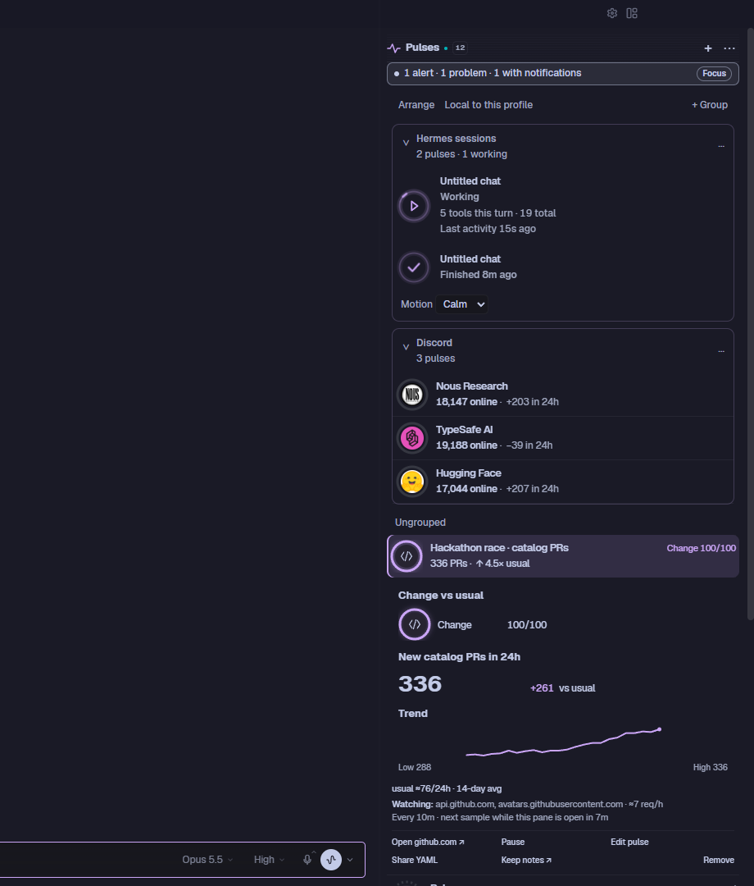
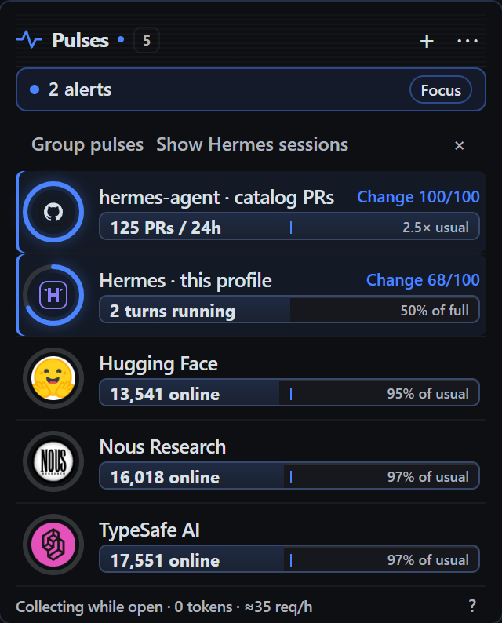
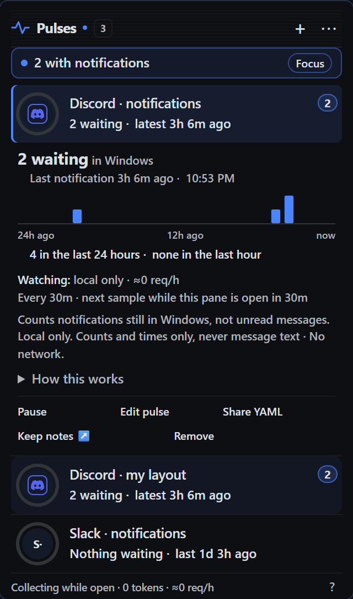
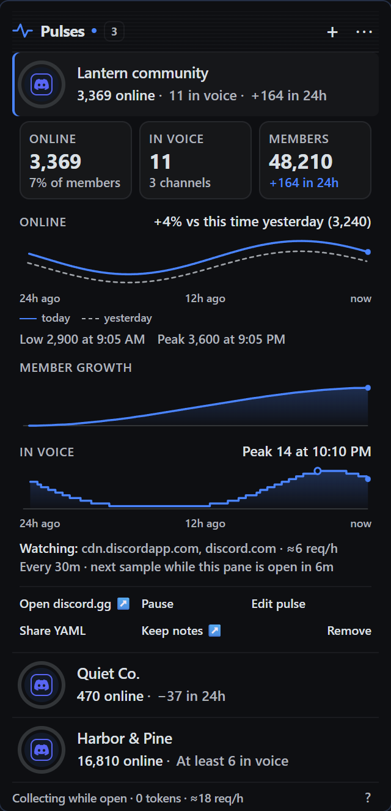
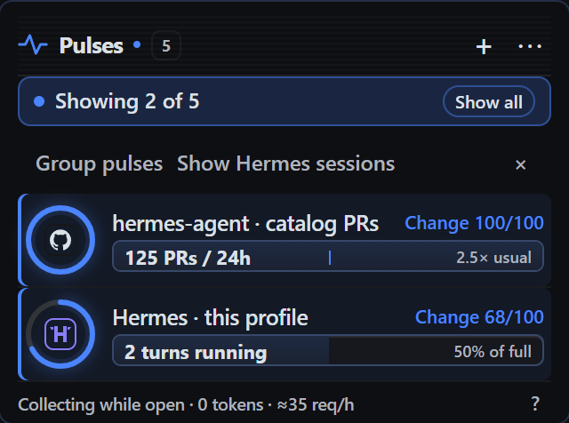
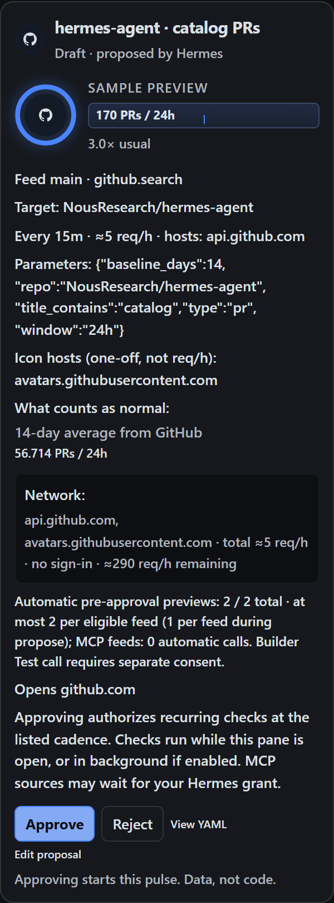
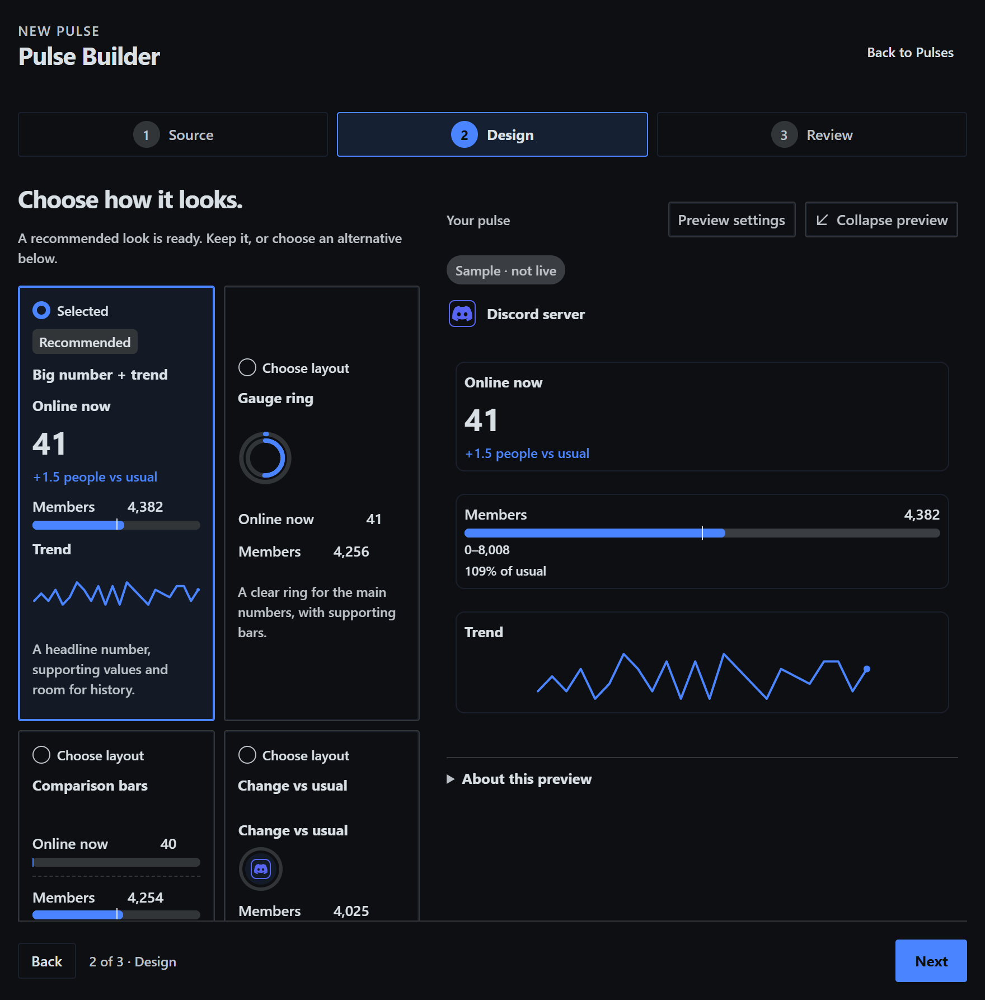

# Pulsr

> **Hackathon entry.** Built for the Nous Research Hermes Agent plugin hackathon
> (November 2026) and submitted as `plugin-catalog/pulse-rings.yaml` to
> [`NousResearch/hermes-agent`](https://github.com/NousResearch/hermes-agent).

**v0.5.0-dev · Hermes >=0.22.7 · MIT**

**Live numbers beside your chat.** Pulsr adds a **Pulses** pane to Hermes
Desktop: small rings, bars, numbers and trend lines that keep themselves up to date
from Discord servers, GitHub, blog and release feeds, public JSON APIs, read-only
MCP tools, Windows notifications and Hermes's own activity.

- **Ask in plain words.** "Keep an eye on catalog PRs in NousResearch/hermes-agent."
  Hermes drafts the pulse. It cannot turn it on.
- **You approve every pulse.** The approval card lists every host the pulse will
  contact and how many requests per hour, before anything runs.
- **A ring means "different from usual".** Each pulse learns its own normal, so a
  quiet day stays quiet and a real change stands out.
- **One line when something needs you.** An alert, a source that cannot recover by
  itself or a draft to review shows as a single strip; one click hides the rest.
- **Zero model tokens to run.** A pulse is a small data-only definition polled by
  the plugin. Refreshing it never calls a model.

## What it looks like

The first image is the pane in Hermes Desktop with live data (public Discord servers
and GitHub repos). The gallery below is sample data drawn by the plugin's own renderer
in the preview harness ([details](docs/screens/README.md)).

<p align="center"></p>

| The pane | Notifications | A Discord server |
|---|---|---|
|  |  |  |

| Focus | Approval | Builder |
|---|---|---|
|  |  |  |

## What you can watch

| Source | What it measures | Reaches |
|---|---|---|
| Discord server (public invite) | People online, members, voice activity where the server makes it public | `discord.com`, `cdn.discordapp.com` |
| GitHub repository | Stars, forks, open issues and PRs; optionally commits, last push and CI | `api.github.com` |
| GitHub search | New PRs or issues matching a query, against a multi-day average | `api.github.com` |
| New posts (RSS, Atom, JSON Feed) | The latest post titles from a blog, channel or subreddit, with how many are new | Only the HTTPS host you approve |
| GitHub releases | The latest releases of a repository, by name | `github.com` (its public release feed) |
| Public JSON API | Any numbers at JSON paths you choose (weather, prices, your own service) | Only the HTTPS hosts you approve |
| MCP tool (read-only) | Numbers from a connected MCP server's read-only tool | Through Hermes; no direct network |
| Windows notifications | How many notifications from chosen apps are waiting | Local only |
| Hermes activity | Running turns, tool calls, errors, requests waiting on you | Local only |
| Hermes sessions (optional) | A live row per session: title, working/idle/done and tool-call counts | Local only |

A pulse can combine up to three feeds and show them as rings, bars, headline
numbers and trends. The built-in builder (Source → Design → Review) previews the
layout as you edit, and every pulse can be shared as YAML.

## Install

Requires Hermes `>=0.22.7`. That floor has not been verified by a clean install on
exactly 0.22.7.

```sh
hermes plugins install Stormxftw/Pulsr --enable   # from this repository
hermes plugins install pulse-rings                # once the catalog entry is merged
```

Or from a local checkout:

```sh
hermes plugins validate /absolute/path/to/pulse-rings --install-deps
hermes plugins install file:///absolute/path/to/pulse-rings --enable
```

Windows Git Bash: use the two-slash spelling `file://C:/path/to/pulse-rings`
(drive letter directly after the two slashes). The **Pulses** panel appears on the
right side of Hermes Desktop after install; turn it off any time in
Capabilities → Plugins. Agent tools load in new sessions. If you update the
plugin while Desktop is open, refresh the window or run **Reload desktop plugins**.

```sh
hermes plugins disable pulse-rings
hermes plugins remove pulse-rings
```

Unwatching preserves history/notes; removing the plugin is not a request to erase
profile data. Keep or delete that separately after review.

## Quickstart

1. Open **Pulses** on the right. Say **“Keep an eye on catalog PRs in the
   NousResearch/hermes-agent repo.”** The `+` button opens the New pulse builder.
2. Hermes uses `pulse_rings_catalog`, `pulse_rings_layout_check`, then
   `pulse_rings_propose`. Review every feed, cadence, full URL (for JSON), preview
   and summed network allocation on the card.
3. Click **Approve**, or use the pending row. A confirmed cached readback, not the
   POST response alone, establishes **Live in Pulses**.
4. Click a row for Details, Open, Pause, Edit, notes or Remove. Keep notes composes an
   **unsent** request for `pulse-rings:pulse-notes`, never a job. The compact
   `pulse_rings_status` includes the exact pulse id and `note_path`, not note text.
   **Import YAML…** opens the builder. **Share YAML** copies the saved normalized
   definition through the SDK clipboard; Edit creates a replacement draft. The
   format and examples are public.

Without Desktop: `/rings list`, `/rings show <id>`, `/rings approve <draft-id>` or
`/rings reject <draft-id>`. CLI/TUI local typed decisions need no gateway.
Messaging additionally requires the stable sender `platform:user_id` in plugin
setting `approver_ids` (default empty), plus the gateway's own allowlist/command
permissions. Missing identity fails closed. Consent UX is **not a sandbox against
a hostile local agent with shell or host API access**.

## Safety at a glance

- **Approval is human-only.** There is no approval tool. An agent can propose;
  only a person's click (or a typed local command) activates a pulse.
- **Definitions are data, not code.** A pulse names a source, metrics and a layout.
  It cannot run commands or scripts.
- **Network use is disclosed and budgeted.** Fixed hosts for Discord and GitHub,
  plus only the HTTPS hosts you approve for JSON pulses, within an hourly request
  budget shown on every card. The builder's city and game **Find** buttons send
  one query, when you click them, to `geocoding-api.open-meteo.com` or
  `store.steampowered.com`.
- **Local by default.** History, icons and notes stay in this Hermes profile. No
  telemetry, no self-update.
- **Opt-in extras are off until you turn them on:** background collection, Hermes
  session rows, and an optional GitHub token read through Hermes's secret store.

The full disclosure is in
[Privacy, network and permissions](#privacy-network-and-permissions-catalog-rule-13).

**Contributing:** issues and pull requests are welcome. Read
[CONTRIBUTING.md](CONTRIBUTING.md) before opening a branch.

## How it works

Tell Hermes what matters. It drafts a **pulse**—a small data-only definition—you
review the source and request budget, then approve it. A ring in the right-hand
Desktop panel shows how unusual a signal is; the capsule shows the real number.
**No Pulsr model calls or tokens per refresh.** MCP servers have their own
Hermes-managed capabilities; see [MCP connectors](#mcp-connectors).

- **Discord:** public invite counts and optional public-widget voice counts
  (active channels, and how many listed members are in voice; the widget lists at
  most 100 members, so on large servers that is a minimum). The cell charts the last
  day: online against yesterday, net member growth, and people in voice. No
  sign-in, messages, joins, scraping or self-bot.
- **GitHub:** repository and structured search counts against a historical average.
- **Hermes itself:** profile-local running turns, tools, errors and requests waiting
  for you, collected through eight observer hooks.
- **MCP connectors:** `mcp.tool` turns numeric output from a connected, explicitly
  read-only MCP tool into a pulse. Hermes handles connector transport and sign-in.
- **Public JSON:** `http_json` selects finite numeric values with JSON Pointers,
  only after you approve the full HTTPS URL. No executable selectors/custom auth.
- **New posts:** `web.feed` reads an RSS, Atom or JSON feed you approve and lists
  its newest post titles in the pane, with how many arrived in the last day and
  week. Titles are shown as plain text and are never sent to the model; the
  agent's status tool gets counts and times only. The **GitHub releases**
  template is the same kind pointed at a repository's public release feed on
  `github.com`.

- **Block toolkit:** build gauges (`rings`/`bar`), comparisons (`bars`), headline
  values/deltas (`stat`), trends (`spark`) and weighted unusualness (`score`). Up to
  three independently paced feeds share a pulse; use fixed, source-limit-bound,
  auto-learning or usual-baseline ranges. Scoped theme/style and bundled brand
  logos are data, not executable CSS or remote code.

Pending rows remain discoverable even if the agent forgets the chat card. Unknown
is never measured zero. Details show baseline, freshness, source and budget. Narrow
the pane for a rings-only strip; keyboard navigation and reduced motion work.

## Show Hermes sessions (opt-in)

Pulses → **⋯ → Show Hermes sessions** is **off by default**. The human click
sends strict boolean consent to `PUT /settings`, then reads the saved setting
back. It creates no pulse definition, approval draft, model turn or external
request. The separate background-collection setting is unchanged.

Each observed session gets a local `session:<hash>` pulse inside the reserved
**Hermes sessions** group (`hermes-sessions`) in the normal arrangement. It is
auto-created on opt-in and removed from the arrangement on opt-out. Rename,
collapse and group-order controls use the same local `/layout` save/readback;
sessions cannot leave this reserved group. It shows the session title,
Working / Idle / Done, tool calls this turn and in total, last activity and
finished age (with the exact local finish time on hover). Click to focus the chat.
Collapse the group for a four-column circle grid; keyboard Tab focus/hover reveals
all the same metadata. Calm motion is the default: a tapered accent comet,
breathing glow, brief tool-call ripple and completion tick. None/Lively and the
system reduced-motion preference are respected. Hidden/off-screen rings pause;
hidden panes stop session/title reads. `sessions.updated` is a local plugin event,
**not a network host**; it only invalidates the local activity query. A three-second
local polling fallback handles hosts without events.

**Data access / retention:** official observer hooks read only session/turn ids,
parent-child relationships and event timestamps/counters. No prompts, goals,
transcripts, tool names/arguments/results or model payloads are inspected. Raw ids
exist only in process memory for SDK title matching/chat navigation. Titles come
from public `host.request('session.list')`; the renderer retains only bounded
id/title projections, never transcripts. Backend storage is bounded to 128 sessions
and 256 child mappings per profile; subagent activity rolls into its parent.
Session counters/times do **not** enter SQLite, notes, definitions or exports.
Customized `layout.json` can retain opaque hashed references and group preferences,
never raw session ids, titles or activity. Removed references are pruned on read.
Done lingers 15 minutes; disabling clears observations and renderer caches. A process
restart loses observations by design. The boolean consent and local group/motion
preferences persist through the existing public settings/layout/SDK storage APIs.

Coverage starts when consent is enabled **in this Hermes process**. Other CLI
processes are not silently scraped. Already-running Desktop sessions can appear
from public busy state before their next hook; unobserved counts/time are labelled
unknown, not zero. Runtime/stored ids are mapped from the public focused-session
atoms when available. Missing hooks/SDK fields fail soft; without a finish hook,
Working falls back to Idle after two hours without observed activity, never an
invented completion. Recent titles outside the bounded session-list window use
“Hermes session” as a fallback. Source/API compatibility was checked against
a Hermes checkout at `v0.22.7-90-g29a61cb7ab5` and an isolated
checkout at tag `v0.23.0`; not a clean minimum-version install.
The real SDK Tip requires keyboard modality **and** `:focus-visible`: Tab/arrow
navigation opens metadata, while pointer-driven focus restoration does not.
No new private host imports, remote services, shell commands or background workers.

## Groups and arrangement (local UI state)

Choose **Pulse options → Arrange pulses…** to show move handles and the **+ Group**
action. Drag rows or circle icons above/below each other, between groups, and into
one level of subgroups. Drag a group handle to reorder groups. **Alt+↑/↓** moves a
focused pulse within its list; **Move to…** also offers Ungrouped and New group.
Escape cancels a drag. Near the pane edges, dragging scrolls the pane. Reduced
motion removes reflow animations. **Done arranging** hides the handles.

Collapse keeps live ring circles in **four columns**, with each subgroup on its
own labelled rows. Hover or focus a circle for the same capsule/status tooltip;
click or Enter opens that pulse. Group menus offer Rename, New subgroup, Ungroup,
and confirmed Delete group. Ungroup/delete never deletes a pulse. Draft approvals
stay outside arrangement. The reserved `hermes-sessions` group can be renamed,
collapsed and reordered; sessions cannot be moved out of it.

**Data disclosure:** arrangement reads/writes only this profile's plugin-owned
`layout.json` (group names, collapse flags, pulse references and array order), up to
64 KiB. It never edits definitions, grants or approvals, shares layout, reads other
profiles, calls a source, or sends layout over the network. `layout-*.tmp` files
are same-directory atomic-write staging, removed on normal failure/success.
The existing profile SQLite write lock serializes compare-and-swap saves across
processes; it stores no new layout table. Optimistic changes are confirmed by a
cached GET readback; failed/stale saves restore the previous order and show a quiet
toast, without replaying the mutation. A corrupt/oversized local layout fails closed
and is not overwritten. No new background processes or dependencies.

API: **GET /layout** → `{layout, revision, customized}`; **PUT /layout** accepts exactly
`{layout, revision}` and returns that envelope. `customized` is false until the first
save: untouched profiles retain automatic hot-first sorting; any user arrangement
fixes array order. Revision is a SHA-256
content ETag; stale writes get **409**, invalid models **400**, malformed envelopes
**422**, unavailable storage **503**. Both routes are plain-def, profile-scoped,
`Cache-Control: no-store`, and do not start collection. Removed references are
pruned and new approvals append to Ungrouped on read. Layout is never part of a
shared pulse definition or an approval payload.


## Bring your Discord Pulse history

Pulses → **⋯ → Import from Discord Pulse…**, or the first-run **Review import…**
banner, opens a read-only plan: admitted pulse/sample/note counts, skipped existing,
invalid and over-cap/budget rows, and recurring network allocation. **Confirm
import** sends literal consent and the exact plan token. A changed source or
destination requires cancel/reopen and renewed review. The banner only checks
source existence/destination marker, never reads the old DB.

The one-time importer reads
`<HERMES_HOME>/plugin-data/discord-pulse/pulse.sqlite3` with SQLite `mode=ro` and
`immutable=1`, then copies online/member history, bounded UTF-8 notes and
magic-validated PNG/JPEG/WebP icons into this profile's Pulsr directory.
Existing IDs/notes/icons are never overwritten; invite-code case is preserved.
Close the old plugin first if it has a pending WAL/journal. Import itself makes
**no network request**, source write or automatic disable/configuration change.
Consent can complete with zero new pulses if none fit; review skipped counts.
**Disable Discord Pulse yourself afterwards** to avoid double polling; its original
data is kept. SQLite changes/marker are atomic; file copies and SQLite cannot be
power-loss atomic together.

## Current release contract (0.5.0-dev)

- Exactly four agent tools: `pulse_rings_catalog`, `pulse_rings_layout_check`,
  `pulse_rings_propose`, `pulse_rings_status`. No decision/activation tool.
- Automatic previews: up to 2 dispatches per eligible fixed-host feed, so up to 6
  for three feeds; at most one during propose and one per later viewed tick.
  Only interactive fixed Discord/GitHub feeds are eligible. MCP/http_json and
  unattended proposals never automatically preview.
- **Builder Test call:** a separate human checkbox + button, strict literal
  consent, before pulse approval. Exactly one read-only/no-spend MCP dispatch;
  no retries, activation or persistence. Raw decoded output may contain private
  data and is shown transiently in Desktop, not secret-redacted. A 10-second
  per-profile/server/tool ephemeral gate applies; it shares four MCP worker slots,
  one-in-flight exclusion, the eight-second caller deadline, live refusal policy
  and 256 KiB decoder cap. Text is capped at 64 KiB; truncated results expose no
  bindable numeric body. There is **no ordinary Net budget reservation** for this
  inspection; the local test gate, not recurring request accounting, limits it.
  Do not use agent tools to imitate that human consent.
- Builder actions: New (`+`), Edit replacement, Open pending in builder, Import
  YAML/JSON, two-way definition editing, block ordering and sample/cached/measured
  previews. Sample is explicitly synthetic; cached/measured do not poll merely
  to preview edits. Save creates a draft for review; only the human approves.
  Share YAML copies a saved normalized definition, not private test output.
- Offline artwork: Simple Icons **16.36.0**, **3,465** icons, **4,811,947 bytes**;
  CC0-1.0 grants no trademark rights or endorsement. Explicit ARTWORK SCOPE
  excludes entire slug/title/upstream-source matches for crypto_mining and
  tunnel_service, not renamed/encoded artwork. Every excluded slug and reason
  is in `pulse_rings/BRANDS-LICENSE.md`; this is not a complete upstream set.
- Source icons follow the hero block's first metric/component feed. Destinations
  include `discord.com`, `cdn.discordapp.com`, `api.github.com`,
  `avatars.githubusercontent.com`, user-approved HTTPS JSON/icon URL hosts, and
  MCP HTTPS icon hosts **only when disclosed in the persisted approval budget**.
  Undisclosed MCP icon hosts are skipped; data rasters and bundled paths are local.
  Open-link hosts are separate from polling/icon consent.
- Background collection is default OFF. Opt-in collects approved feeds through a
  five-second daemon, not draft previews; toasts still need a visible Desktop.

## Repository activity (optional)

GitHub repo keeps its existing stars/forks/issues/PRs preset and **8 req/h at the
15m default**. Opt in with `activity: true` for commits this GitHub week versus
the previous 12-week mean and live time since push; `ci: true` adds latest
Actions run pass/fail/running on the default branch. Builder → GitHub repo offers
Commits this week, Last push and CI build status checkboxes; choose all three for
**Repo activity** (source-baseline score ring, duration stat, Passing/Failing stat).
See [ready definition](examples/e-repo-activity.pulse.yaml).

**Network disclosure:** same `api.github.com` host. GET repo metadata and open PRs:
2 calls/poll; activity adds `/repos/{repo}/stats/participation` at most hourly,
including 202 retries (+1 req/h); CI adds `/repos/{repo}/actions/runs?branch=<default_branch>&per_page=1`
(+1 call/poll). Push age adds no call and refreshes locally. At 10m: neither=12,
activity=13, CI=18, both=**19 req/h**; at 15m: 8/9/12/13 req/h respectively.
No new hosts, background processes or credential stores. Source avatars still
separately disclose `avatars.githubusercontent.com`; bundled GitHub logo is offline.
Private repos work only with your own fine-grained read-only token configured in
Hermes Settings (`PULSE_RINGS_GITHUB_TOKEN`), accessed only through scoped Hermes
secrets; grant repo metadata/contents read and Actions read for CI. Never include
credentials in definitions. Missing Actions access is unknown, not Failing.
GitHub may take time to compute stats (202 stays unknown until the hourly refresh).
Only the latest run is requested: while it is queued/running the conclusion is
unknown, not the result of an older build. No live/private-repo validation is implied.

## MCP connectors

Add/connect an MCP server through [Hermes's MCP setup](https://hermes-agent.nousresearch.com/docs/user-guide/features/mcp),
complete any connector sign-in interactively in Hermes, then ask, for example,
**“Keep an eye on the count from my metrics connector.”** Hermes calls the tool
normally to learn its JSON output shape, then drafts numeric JSON Pointers. That
ordinary agent call is separate from Pulsr and follows the host's normal
tool policy. Pulsr makes **no automatic MCP previews** during propose or
viewed ticks. The builder has a separate, explicitly human-consented **Test call**
before pulse approval (details below). Review and approve exact server/tool/args/cadence.

Illustrative definition, **not a bundled/configured connector**: for a server
`metrics`, tool `read_counts`, whose decoded result is `{"count":42}`:

```yaml
pulse: 1
title: Metrics · count
source:
  kind: mcp.tool
  params:
    server: metrics
    tool: read_counts
    args: {}
    metrics: {count: /count}
every: 15m
```

- **Hermes owns the connector:** calls use public `PluginContext.call_mcp(server, tool, arguments, timeout=8)`. Pulsr makes no direct network connection for
  this kind and never reads/stores connector credentials. Hermes's MCP client
  handles stdio/HTTP transport and sign-in, including MCP OAuth. The server may
  access private data, files or network services under its own configured authority;
  this is **not** `http_json`'s public-HTTPS/IP-pinned transport.
- **Read-only, fail-closed:** before dispatch, live host policy must confirm the
  tool's discovered `readOnlyHint=true`. Missing/unknown policy or a write-capable
  tool is refused. Servers with any declared spend/cost policy are refused, even
  nominally free calls. Read-only annotations are a server claim, not a sandbox or
  proof that a dishonest server cannot cause effects. Choose trusted connectors.
- **No prompts from polls:** finite-turn and suppressed-interactive-OAuth scopes
  decline server elicitation and interactive sign-in instead of prompting. If
  reconnection needs sign-in, finish it in Hermes interactively, not on a refresh.
  These scopes do not disable every server capability: server-initiated MCP
  sampling remains a Hermes/server setting and may use model tokens if enabled.
  Disable sampling for a connector intended to be strictly model-free.
- **Trust boundary:** Hermes's MCP trust gate still applies inside the tool
  handler, but `call_mcp` invokes the native handler directly: other plugins'
  `pre_tool_call` hooks (including airlock-style guards) **do not run for these
  polls**. Mitigations are the read-only check and human approval of the exact
  server/tool/args; do not rely on those hooks to protect recurring polls.
- **Reviewable card:** server, tool, escaped JSON args, a read-only badge from live
  host policy, and **“via Hermes MCP connector (Hermes handles sign-in)”**. Args
  longer than 512 displayed characters are marked truncated; review the full
  definition. A definition's own `x-*` claims cannot grant the badge or permission.
- **Bounds and storage:** default 15m, minimum 5m, one counted call/poll (4 req/h
  by default) against the profile ceiling; no direct hosts in `budget.hosts` does
  **not** mean no connector network activity. The eight-second wait deadline uses
  a daemon worker, with at most four concurrent MCP calls per process and one
  in flight per profile/server/tool. A hung call cannot be forcibly killed; it
  holds its slot until it returns. Late results are never persisted. Sanitized
  errors defer retries and preserve cached values. Hermes caps envelopes at ~64K
  characters (~64 KB documented); a 256 KiB secondary decoded-body limit remains
  at the adapter boundary; this is not a transport streaming/memory cap in Hermes.
  Truncated envelopes produce unknown metrics, never partial parsing. Pointers
  select `structuredContent` when present (even null), otherwise the once-decoded
  `result` JSON body; neither `ok` nor the outer envelope is part of a pointer.
  Only selected finite numeric metrics enter samples; raw output, args and server
  error text never enter samples/source state/metadata/errors. **Args do persist
  in the approved definition/draft**, so never put secrets in them. The
  credential-key guard is not a detector for secrets hidden in values.

**Current limits:** the MCP connection and plugin context must exist in the
**same Hermes process that polls**. An agent session's connection is not shared
magically with a separate dashboard process: unavailable policy/connection yields
an honest unavailable error, not invented values. Cached reads never dispatch.
Nous-gateway hosted connectors (for example Gmail reached via `tool_search` /
`tool_call`) are **not supported yet**. Only registered `mcp__…` tools with
JSON-compatible numeric output work; arbitrary text, counting arrays and executable
selectors are not supported. See [the normative contract](spec/PULSE-1.md#mcp-tool).

### Hermes per-server grant (separate from pulse approval)

The operator must add the exact server, for example `metrics`, to
`plugins.entries.pulse-rings.mcp_allowlist` in Hermes `config.yaml`:

```yaml
plugins:
  entries:
    pulse-rings:
      mcp_allowlist: ["metrics"]
```

This is an operator setting, **not** `settings.mcp_allowlist`. Pulsr never
writes it or calls `ctx.set_config` to grant access. Approval and the Hermes grant
can happen in either order. Cards and the builder show **Hermes grant: Allowed in
Hermes settings** or **Not yet allowed — add "metrics" to
plugins.entries.pulse-rings.mcp_allowlist**. An approved pulse waits in
`needs_mcp_grant` without remote-failure/exponential-backoff spam. Builder Test call
explains the same requirement when refused. Hermes rechecks the grant on every
`ctx.call_mcp(server, tool, arguments, timeout=8)` call; revocation is respected.
The per-server grant permits more than read-only tools at the host level, so
Pulsr still independently refuses unmarked/write-capable or costed tools.

## Desktop notifications (Windows)

`desktop.notifications` turns notifications from desktop apps into a pulse: how
many are **waiting**, how many arrived in the last hour/day, and how long since
the last one. Pick an app in the builder (**Desktop notifications** template) or
ask Hermes, for example “keep an eye on my Discord pings and warn me past 3”.

```yaml
pulse: 1
title: Discord pings
source: {kind: desktop.notifications, params: {apps: [discord]}}
alert: {metric: waiting, above: 3, notify: toast}
icon: {brand: discord}
```

A notifications pulse is drawn in **notification mode**: the row reads `2 waiting
· latest 3h ago` with a count pill, or `Nothing waiting · last 1d 3h ago`, and
joins the pane's "needs you" strip while something is waiting. Expanded, one
card gives the count, when the last one arrived, and the last 24 hours hour by
hour. A pulse without its own display blocks (like the one above) shows only
that card; one designed in the builder keeps its blocks under it.

On Windows, a pulse that watches exactly one app (the one above) **opens that app
when you click its row**; details move to the small ▸ button at the row's right.
Only `discord`, `teams`, `outlook`, `whatsapp`, `telegram`, `chrome`, `edge`,
`claude` and `hermes` can be opened, and only once the pulse has seen that app's
notifications on this PC, so it opens the variant you have installed. Pulses that
watch several apps or use `app_ids` keep the click-to-expand row.

**Message previews (opt-in).** Tick **Show message previews** in the builder, or
add `preview: true`, and the row also shows who each waiting notification is
from and its text, one at a time, the next every 4 seconds (`Ada (#general,
Server): See you at four? · 1/3`). Hovering or focusing the row holds it,
reduced motion keeps the newest, and the expanded card lists them all. At most 5,
each line cut to 120 characters, plain text only. The text is read from Windows
only when the pane refreshes, kept in memory for a few seconds and shown only in
the pane: never saved, logged, or sent to Hermes or the model. It is off by
default, and turning it on is a new approval whose card says so.

```yaml
source: {kind: desktop.notifications, params: {apps: [discord], preview: true}}
```

- Curated `apps`: `discord`, `teams`, `outlook`, `slack`, `whatsapp`, `telegram`,
  `signal`, `spotify`, `chrome`, `edge`, `claude`, `hermes`, `phone_discord`
  (Phone Link). Anything else: exact Windows app IDs in `app_ids`.
- **Counts and times only, never message text, no network**, unless you approve
  message previews (above), which show text in the pane only. Read-only access to
  the Windows notification store and per-app registry timestamps; see the
  rule-13 disclosure below.
- `new_1h` / `new_24h` stay **unknown** until the pulse has watched continuously
  for the whole window (turn on background collection for 24h counts). Apps
  like Discord remove their own toasts once you read the message; the registry
  timestamp still records that one arrived, but several that arrive and clear
  within one poll count once.
- Unknown store formats, notifications switched off, unregistered apps and
  non-Windows hosts show **unknown**, never zero.

## Agent tools

| Tool | Inputs | Effect |
|---|---|---|
| `pulse_rings_catalog` | optional `brand_query` (1–80 nonblank chars) | Offline kind/block/scale/style/icon/feed toolkit; up to 10 matching brand slugs/titles. Successful response ≤65,536 UTF-8 bytes. |
| `pulse_rings_layout_check` | `definition` (object or JSON/YAML text) | Pure validation, normalized definition, exact budget, plain-text block/item descriptions and advisory warnings. No engine construction, store writes or network; works under every origin. |
| `pulse_rings_propose` | `definition`, optional `note`, `replaces` | Pending draft only; returns path/message errors, original card token and summary of every feed plus total budget and icon hosts. |
| `pulse_rings_status` | none | Cached values, freshness and pending drafts; never polls. |

Always layout-check before proposing. Prefer the source's matching limit/total for
metric-bound maxima, natural 0–100 for percentages, a user's stated range next,
otherwise auto. Explain that basis in `note`. Auto needs three measured points
spanning an hour; it is not a forecast. Unknown values/bounds are never zero.
Re-tuning uses cached status followed by a checked replacement draft, not a live
edit. Warnings (possible limit sibling, >2 hero rings, hex contrast below 3:1) are
advisory; contrast is checked only against an explicit opaque hex theme surface,
never guessed token/default colours. Layout check validates intent, not real data
availability, live MCP permission, quota admission or successful rendering.

Multi-feed summaries list each kind/target/cadence/exact req/h and the summed
allocation; icons add disclosed hosts but no recurring requests/hour. Offline
brand search returns no artwork payloads and makes no discovery/network call.
Explicit icon URL hosts are separately disclosed one-off destinations. MCP icon
metadata cannot add undisclosed hosts; empty direct MCP hosts is not no network.
**There is no approval tool.** Human activation and unattended preview rules are
unchanged. The [authoring skill](skills/authoring/SKILL.md) has worked examples.

Source-changing replacements (including JSON-pointer changes) reset that feed's
current/history-derived scales and baselines to warming/learning; old samples stay
archived, not reused. Pure layout/theme/title/cadence edits and unchanged legacy
single-source identities keep compatible history/state. Removed/renamed feeds do
not resurrect observations when a name is reused; old in-flight completions are ignored.

## The pulse/1 standard

[spec/PULSE-1.md](spec/PULSE-1.md) defines the data format, with a
[JSON Schema](spec/pulse-1.schema.json), [examples](examples/) and
[read-model contract](spec/INTERFACE.md). Definitions describe source, cadence,
ring, capsule, lines and optional alert. They cannot add code, remote adapters or
executable selectors. Imports go through the same draft/approval gate.

```yaml
pulse: 1
title: Hermes · this profile
source: {kind: hermes.activity, params: {scope: profile}}
```

Only history-derived median/oldest deltas wait for prior observations. Source/fixed
baselines and measured levels score immediately. An entirely history-derived ring
warms together; all-unknown rings say **Not measured**. Discord's frozen weights
(presence 70, members 20, voice 10) are not a popularity ranking; missing widget
voice is not renormalized across communities.

**The generalized engine reproduces Discord Pulse v0.3.0 scores exactly on recorded data.**
The golden tests compare numeric scores/components/baselines/deltas/capsule fill
against an independent frozen oracle on recorded fixtures plus **37 real counts-only
snapshots across three guilds** (17 sequences / 64 steps). Presentation strings and
corrected first-sample level/warming rules are not claimed identical; a synthetic
first sample with measured voice is a separate conformance test. This is recorded
series evidence, not proof for every input or live collection.

## Polling, limits and security model

- **Collect while viewed:** status ticks every 15 seconds (2.5 while a preview is
  sampling), at most one due source operation per tick. SDK visibility support
  pauses hidden views; older hosts without it fall back to mounted-view polling.
  Multiple windows share durable gates. `/status?poll=0` and the agent status tool
  never collect. Discord baselines describe **while you were looking**; recorded
  gaps were 16–50 minutes, not continuous monitoring.
- **Bounds:** 24 active pulses, 5 pending drafts, seven-day draft expiry and
  **300 recurring requests/hour** by default. Exact admission is rechecked
  atomically at approval/import; display rounds up. At least two seconds between
  calls to a host. Local pacing defers without remote failures; remote limits
  persist backoff (six-hour clamp; 24 hours for missing sources).
- **Direct HTTP responses:** HTTPS/443, no redirects, 512 KiB JSON / 256 KiB image caps, eight-second
  sources/four-second fixed-host icons, MIME/magic-byte checks and strict finite
  numbers. Corrupt rows are isolated; samples contain no raw response bodies.
- **http_json fail-closed:** both public Hermes APIs `is_safe_url` and
  `create_ssrf_safe_async_client` must be importable and callable. Unavailable
  means disabled—**no standalone fallback**. `is_safe_url` checks the origin;
  actual requests use our stricter stdlib numeric-IP-pinned TLS transport, **not**
  the generic Hermes async client. Every DNS answer is vetted; private, loopback,
  link-local, metadata, mapped, multicast and transition-wrapper IPs are refused.
  The socket dials a vetted IP with the approved TLS SNI/certificate/Host. No
  proxy environment, auth headers, cookies or compression. Bounded temporary DNS
  helpers never initiate HTTP; a per-request eight-second watchdog is canceled.
- **Renderer/core boundary:** SDK/React only, no remote scripts, HTML injection or
  app-markup selectors. Icons are validated local raster data URLs or bundled SVG path attributes. The loader
  registers only this plugin's **path-unique package** for adjacent relative
  imports, never replaces Hermes/core modules or changes `sys.path`.

### Core boundary justifications (catalog rule 9)

**Plugin package loader:** the path-unique package entry in `sys.modules` supports
adjacent relative imports only. It does not replace a Hermes/core module, patch
host functions/tables or alter `sys.path`; this is not a core override.

**MCP metadata compatibility shim (before → after WP12):** Hermes 0.22.7+
and v0.23.0 document public `ctx.call_mcp`; both polling and builder Test call now
use it instead of `dispatch_tool`. Neither version exposes the discovered
read-only/cost policy through a public plugin metadata API. Prefer future
`ctx.tool_info(name)`; missing/changed private safety seams still fail closed.

| Private seam | Before WP12 | After WP12 |
|---|---|---|
| `tools.mcp_tool_handlers._tool_is_read_only` | Positive discovered hint | Retained; no public equivalent |
| `tools.mcp_tool_scope._server_key` + `tools.mcp_tool._server_cost_policies` | Refuse every cost policy | Retained; host spend gates may charge within budget and prompt over budget |
| `tools.mcp_tool_scope._resolve_server_key` + `tools.mcp_tool._servers` | Connection-presence check **and** declared icon lookup | Connection-presence check removed; **icons only** remain |
| `gateway.session_finite.finite_turn_scope` | Decline elicitation | Retained; public call_mcp does not install a noninteractive scope |
| `tools.mcp_oauth.suppress_interactive_oauth` | Suppress interactive sign-in | Retained; public call_mcp can reconnect/auth-recover |
| MCP task `_tools` / `initialize_result` (icon_resolver.py) | Declared icon metadata | Unchanged; no transport/connection authority |

Public scoped registry lookup is retained for tool existence. `call_mcp` handles
connection failures/reconnects through its error envelope; we no longer inspect a
private connection table to decide if invocation is possible. Grant disclosure
reads `hermes_cli.config.load_config`, the same public accessor/tree used by
`call_mcp`: `ctx.get_config` is **settings-relative** and cannot read this
entry-level operator grant. Reads execute inside the captured profile context.

Source justification ([v0.23.0 plugins.py:502–566](https://github.com/NousResearch/hermes-agent/blob/v0.23.0/hermes_cli/plugins.py#L502-L566)):
`call_mcp` checks the grant, calls the native handler and normalizes its envelope;
it does not install no-prompt scopes. [mcp_tool_handlers.py:123–208](https://github.com/NousResearch/hermes-agent/blob/v0.23.0/tools/mcp_tool_handlers.py#L123-L208)
reserves charges within a spend limit and asks over it: documented spend-limit
preservation is **not** a guarantee of no spend/no prompts for unattended polls.
The handler copies the calling context for elicitation and performs reconnect/auth
recovery ([692–744](https://github.com/NousResearch/hermes-agent/blob/v0.23.0/tools/mcp_tool_handlers.py#L692-L744)).
Finite turns decline consent in [approval_prompt.py:316–319](https://github.com/NousResearch/hermes-agent/blob/v0.23.0/tools/approval_prompt.py#L316-L319)
via [approval_context.py:207–212](https://github.com/NousResearch/hermes-agent/blob/v0.23.0/tools/approval_context.py#L207-L212).
OAuth otherwise defaults interactive and may open a browser; suppression prevents
that ([mcp_oauth.py:334–374](https://github.com/NousResearch/hermes-agent/blob/v0.23.0/tools/mcp_oauth.py#L334-L374),
[811–820](https://github.com/NousResearch/hermes-agent/blob/v0.23.0/tools/mcp_oauth.py#L811-L820)).

No host table/function is modified or rebound. Undocumented-core imports remain
validator warnings needing maintainer review, not a warning-free admission claim.
The narrowed [upstream issue draft](submission/UPSTREAM-ISSUE-mcp-readonly.md)
requests public discovered read-only/cost metadata beside `call_mcp`; not posted.
A public no-prompt scope and icon metadata would remove separate residual seams.

## Privacy, network and permissions (catalog rule 13)

- **Network, only for pulses you approve (except fixed-host previews, a consented builder Test call and the builder lookups below):**
  `discord.com` (invite counts, optional public widget), `cdn.discordapp.com`
  (server icons), `api.github.com` (repository/search counts), `github.com` (a repository's public
  release feed, for a GitHub releases pulse), and for `http_json` and `web.feed`
  **user-approved HTTPS hosts**, exactly the full host/URL shown on the approval
  card. `avatars.githubusercontent.com` supplies GitHub owner/org avatars for
  `icon: source`, only when that exact host was in the persisted approval budget.
  Explicit icon URLs and MCP-declared HTTPS icons likewise require their exact
  disclosed host; undeclared MCP icon hosts are skipped. MCP raster `data:` icons
  decode locally with zero requests. Bundled Simple Icons artwork is offline
  (CC0; trademark rights remain with owners; see `pulse_rings/BRANDS-LICENSE.md`).
  Icons are PNG/WebP/JPEG only, capped at 256 KiB, MIME/magic checked and cached;
  failures are gated for six hours. No remote SVG is accepted. GETs are
  unauthenticated unless you add a GitHub token (never sent to icon hosts).
  Redirects are refused, JSON responses capped at 512 KiB, arbitrary
  hosts use vetted public DNS answers and IP-pinned TLS. Services see your IP and URL
  identifiers. Interactive fixed-host previews dispatch **at most one gated call
  during propose and up to 2 per eligible fixed-host feed**, so **up to 6** for
  three eligible feeds across viewed ticks, only to discord.com or api.github.com,
  without icons/widget fallback. No arbitrary-HTTP or icon fetch before approval;
  a separately consented builder MCP Test call may reach its configured service.
  User-clicked **Open** links can open `github.com`,
  `discord.gg` or a definition's HTTPS link in your browser; legacy parsing also
  accepts `www.discord.com`, never as an automatic fetch destination.
- **MCP connector delegation:** after approval, `mcp.tool` dispatches the exact
  server/tool/args through Hermes; the connector may read private data or contact
  its configured services. Hermes owns transport/OAuth and may run its configured
  stdio server. Pulsr reads live discovery/connection/cost metadata, not
  credentials; no direct MCP network transport or connector credential storage.
  No automatic MCP previews, write-capable tools or declared spend policies;
  the separately consented builder Test call is the only plugin MCP pre-approval exception. Handler trust
  gates remain; other plugins' `pre_tool_call` hooks do not run. Finite/suppressed
  OAuth scopes decline interactive work. Server sampling is a separate host setting.
- **Desktop notifications (`desktop.notifications`, Windows):** reads outside the
  plugin's own data, only for pulses you approve and never before approval: the
  per-user Windows notification store
  `%LOCALAPPDATA%\Microsoft\Windows\Notifications\wpndatabase.db` (opened read-only:
  SQLite `mode=ro` + `query_only`, never copied or written) and per-app values under
  `HKCU\Software\Microsoft\Windows\CurrentVersion\Notifications\Settings` and
  `...\PushNotifications` (`KEY_READ`). Only handler/notification ids, types,
  arrival/expiry times and on/off flags are selected; by default message text,
  senders, payloads, tags, groups and `NotificationData` are never queried,
  stored or logged. **No network requests.** Samples hold counts and minutes; source state
  holds notification ids, timestamps and the definition's own app ids. Unknown
  store formats, disabled notifications and non-Windows hosts report unknown, never zero.
  **Message previews (opt-in, off by default):** only a pulse approved with
  `preview: true`, whose approval card names `· message previews` in its target
  and says what is read, also reads the toast XML (`Payload`, `PayloadType = 'Xml'`)
  of the newest waiting toasts of its own apps: at most 5, the first two plain
  text lines (sender, text), each cut to 120 characters, payloads over 16 KiB or
  with a document type declaration skipped. This happens only when the pane asks
  for status, never during polling or before approval; the text is kept in memory
  for 4 seconds and goes to the pane only. It is never written to samples, source
  state, metadata, the plugin's database or files, logs or errors, and never
  appears in `pulse_rings_status`, the `/rings` command output or any other agent
  tool result. Turning it on (or off) is a new draft and a new approval.
  **Open the app:** a human click on a pulse that watches exactly one launchable
  curated app (`POST /pulses/{id}/open-app`, body `{confirm: true}`) hands Windows
  `shell:AppsFolder\<AUMID>` for that app's code-owned AppUserModelID, the same
  activation the Start menu uses. No arguments, no command line, no network,
  nothing read back; the target never comes from the request, the definition's
  `app_ids` or the agent, and agent tools cannot call it.
- **Builder-only city/game lookups (WP13):** a human Find click with literal
  confirmation sends exactly one query to `geocoding-api.open-meteo.com` (city)
  or `store.steampowered.com` (Steam game search). No request on mount, typing,
  template conversion, preview, or layout selection. These are pre-approval
  one-off lookups, not recurring feed hosts or a pulse approval. Each service sees
  your IP and query. One call per 3 seconds per profile/kind, 3-second deadline,
  256KiB cap, no redirects/retries/credentials; existing public-DNS-vetted,
  IP-pinned JSON safety path fails closed without Hermes safety APIs. At most
  eight projected results; city coordinates rounded to 2dp. Queries/results are
  response-local, never saved in plugin DB/files/logs; only profile/kind pacing
  timestamps live briefly in memory. Steam store links/app IDs parse offline
  with zero calls. The lookup does not approve the weather/air/Steam player
  polling URLs; those remain ordinary `http_json` drafts requiring review.
  The weather/air template proposes `api.open-meteo.com` and
  `air-quality-api.open-meteo.com`; player counts propose `api.steampowered.com`.
  These hosts are contacted only after ordinary pulse approval, not by Find.
  `example.org` in form placeholders is illustrative, never fetched by the forms.
- **Budget:** every pulse shows hosts and requests/hour before approval. A
  profile-wide ceiling (default **300 requests/hour**) and per-host spacing apply.
  HTTP 429 and GitHub rate-limit resets are honoured and persisted.
- **Hermes activity:** observer hooks are `pre_llm_call`, `on_session_end`,
  `post_tool_call`, `on_human_input_request`, `on_human_input_resolved`,
  `subagent_start`, `subagent_stop`, `api_request_error`. Only event kinds,
  timestamps, enum outcomes, cron/subagent origin and salted hashes of session,
  request or child ids are recorded in this profile's database. Events retain
  48 hours and prune on next activity/read, not a worker; open pairs have TTLs.
  No prompts, commands, tool arguments/results or model output are stored by hooks.
  Only enabled processes in this profile are observed. Bookkeeping may drop under
  contention or lose recent counters on power failure.
- **Reads/writes:** its own `<HERMES_HOME>/plugin-data/pulse-rings/` (SQLite,
  cached icons, Markdown notes) and shipped metadata. Samples retain seven days;
  history/notes survive unwatch. Banner checks old DB existence only. **Opening
  import review** reads `<HERMES_HOME>/plugin-data/discord-pulse/` read-only;
  **explicit confirmation** copies history/notes/validated icons. Never changes or
  disables its source; WAL/journal refusal prevents unsafe reads. No direct `.env`,
  `auth.json`, browser profile or other credential-store reads; Hermes resolves
  the per-profile secret scope described below.
- **Credentials:** none required. Optional GitHub token in Settings → Plugins →
  Pulsr, stored by Hermes as `PULSE_RINGS_GITHUB_TOKEN`, read only through
  `agent.secret_scope.get_secret`, sent only to `api.github.com`, never logged,
  returned, embedded in definitions or sent to arbitrary hosts. Background ticks
  bind the registering profile's secret scope through Hermes's documented
  `build_profile_secret_scope` / `set_secret_scope` APIs, rebuild it each tick
  to pick up token changes, and reset it even on failure. Older Hermes without
  these APIs retains its existing credential behavior; Pulsr never reads
  credential files or the token from the process environment directly. MCP connector
  sign-in/refresh belongs to Hermes; Pulsr never receives those tokens.
- **Agent authority:** four tools list cached status/the offline toolkit, check
  layouts purely, and propose drafts.
  No approve, import, change or remove tool. Activation is a human Desktop click
  or typed `/rings approve <id>`; messaging also requires explicit sender grants.
  Cron/subagent/kanban/unknown-origin drafts make no preapproval requests, even
  when later viewed, and expire after seven days. Human REST routes inherit
  Hermes authentication/enable/origin guards, never bypass them.
- **Processes:** default OFF; optional **long-running daemon collection thread**
  wakes every five seconds for approved feeds only (see Background collection).
  Turn it off in Pulses options or Settings → Plugins; unload/exit signals stop
  with a bounded 1.5s join. `collection.lock` and a SQLite lease prevent overlapping
  polling. It calls the same budgeted HTTP/MCP/local sources listed above, never
  draft previews. No runtime shell commands, subprocesses, telemetry, analytics,
  usage reporting or self-updates. MCP polls do use up to four daemon call workers per process;
  their caller waits eight seconds, but a stuck handler may outlive that deadline
  until it returns/process exit, holding its slot. Late results cannot be stored.
  Hermes, not Pulsr, manages configured MCP server processes/transports.
  Temporary bounded DNS threads and a canceled per-request timer exist for
  approved http_json requests; late DNS never initiates HTTP. Sources refresh
  through viewed status requests by default, or the opt-in collection thread;
  hooks record whenever your agents run.
  Developer-only preview/test commands launch local Node/browser processes.
- **Definitions are data (`pulse/1`):** nothing is executed, evaluated or rendered
  as HTML. Source text is untrusted data, not instructions.

## Background collection (opt-in)

The default is **OFF**: approved feeds collect only while a visible pane/card
requests status. To keep approved samples and baselines updating while the pane
is closed, use **Pulses → ⋯ → Background collection · Off**. Clicking toggles the
setting, with literal confirmation and a saved-value readback. Turn it off with
the same control, or use **Settings → Plugins → Pulsr → Background collection**
(`plugins.entries.pulse-rings.settings.background_collection`, schema default false).
The pane footer distinguishes **Collecting in background** / **Collecting while open**.

When ON, an enabled Hermes process must remain running with this plugin loaded.
A single daemon scheduler per profile/data root wakes every five seconds and
calls the existing `poll_one_due(previews=False)` path for at most one due,
unpaused, approved feed. It uses the same budgets, profile ceiling, host pacing,
jitter, deferrals, retry backoff and read-only MCP refusal gate. With zero active
pulses it makes no source/icon calls. Drafts never collect in this worker;
interactive previews still require a viewer. Samples feed the usual baseline and
alert calculations on the next cached status read; **toasts still require a visible
Desktop view**, not headless notification delivery.

A SQLite lease records the last tick, with a 30-second expiry and a five-second
minimum tick gap. A process mutex plus the local `collection.lock` OS file lock
fence overlapping polls even if a slow call outlives the lease. A killed process
releases its OS lock; the lease expires. Followers never double-poll; a viewed
refresh can make at most one ordinary due poll when the lease is stale. Locked
SQLite claims use a 50ms busy timeout and 5–60s retry backoff, not a busy loop.

This uses no shell children, cron jobs, model turns or private Hermes scheduler.
Synchronous plugin registration has no guaranteed asyncio loop, so the public
`PluginContext.spawn_task` is unsuitable there; the plugin owns its daemon and
uses public `ctx.on_unload` plus `atexit` for cleanup. See
[public-surface evidence](submission/BACKGROUND-SURFACE.md). ON at plugin load
starts it; dashboard access can start it lazily. Changing OFF→ON in the generic
Plugins settings form takes effect on the next plugin load or dashboard access.
The pane toggle starts it immediately. The pane route writes only through a
captured public `ctx.set_config`; a dashboard without that process-local plugin
context returns 503 with instructions to use Plugins settings, never writes core
configuration itself. Config/profile context is captured before starting threads.

Stopping signals cancellation and waits **at most 1.5s** for the scheduler. An
already-running bounded network/MCP wait cannot be forcibly interrupted by Python;
it may drain on the daemon after stop returns. It cannot initiate another gated
call or persist a late sample, and keeps the OS lock until it returns. A stuck
MCP handler retains the existing MCP worker slot until return/process exit. The
thread cannot keep Hermes alive; no collection continues after process exit.

## Current core verification

Review-3 core fixes have a real isolated admission-engine **exit 0 / ok:true**
receipt, with caution/private-import warnings retained for maintainer review;
this is not a CLI `--install-deps` preparation receipt. Full isolated Python:
**1,295 passed, 1 skipped** (MCP SDK unavailable in test Python). The real scanner
checks ran. See [WP11 core receipt](submission/WP11-CORE.md) for exact commands,
warnings, byte-identical rebuild and actual-baseline database migration evidence.
Final merged UI validation, independent review, authorized live install and
publication remain separate gates.

## Verify

```sh
uv run --isolated --no-project --with 'pytest>=8,<9' --with 'fastapi>=0.115,<1' --with 'httpx>=0.27,<1' --with 'jsonschema>=4,<5' --with 'ruamel.yaml>=0.18,<0.19' python -m pytest tests -q
uv run --isolated --no-project --with 'ruamel.yaml>=0.18,<0.19' python scripts/generate-ui-fixtures.py --scratch /path/to/scratch
node --check desktop/plugin.js
node scripts/preview-server.mjs /path/to/hermes-agent 5198
node scripts/test-widget.mjs /path/to/hermes-agent /path/to/artifacts/screens
```

CI runs isolated tests (mandatory YAML/JSON Schema dependencies, plus metadata,
capability/disclosure/payload greps) and `node --check`. Future badge target only,
not a claimed Actions run:
[](https://github.com/Stormxftw/Pulsr/actions/workflows/ci.yml)

Measurement fixtures are generated by `Engine.status()`. Discord replays the
counts export; pending GitHub cards replay recorded baseline/recent responses:
170 catalog-in-title PRs versus 794/14 per day at capture time, not today's counts
or proof of catalog-file changes. Other states/import inputs are synthetic.

[Submission checklist](submission/CHECKLIST.md) separates local checks from open
gates: independent security review, taste check, authorized live create→approve,
import/hooks/messaging checks, public repo, published SHA, image uploads and demo.

## Opus re-review remediation evidence (FIX-1–FIX-8)

Eight local Conventional Commits address the re-review in order, including Share YAML (option a), alert toasts, approval-card accessibility, calm breathing and honest one-sample details. There is no legacy `/servers` activation API. CLI decisions require a typed user command; REST decisions require `{confirm: true}` from the human surface. The agent propose tool can only draft.

Historical pre-MCP offline verification (FIX-1–FIX-8): **509 pytest tests**, **138 Chromium checks**, zero remote renderer requests and zero runtime warnings. `hermes plugins validate --install-deps` passed in a disposable artifact data root; its `sudo_usage` cautions identify local activity metric names, not privilege escalation. The unchanged defect-present review assertions were rerun with repository/temp paths retargeted to main: **47 fail (defects absent), 1 passes (B7, intentional optional-widget bias)**. Probes for removed legacy entry points fail because those entry points no longer exist; inverted repository regressions cover the supported paths.

The original 24-pulse review workload measured **83 ms / 83 KiB** for full cached status and **75 ms / 38.3 KiB** for compact status; construction was **1.9 ms**. Zero inline icons and zero legacy aliases. These are local measurements, not a cross-machine latency guarantee. Evidence and regenerated screenshots are under `$ARTIFACTS/pulse-rings/fix2/` (`screens/`, `pytest-final.txt`, `browser-final.txt`, `perf-final.txt`, `probes-run.txt`, `validate.txt`). Review source files and the frozen review clone remain unmodified.
